<div align="center">
  
</div>

<div align="center">
  
</div>

<p align="center">
  <a href="mailto:rasyagame06@gmail.com"></a>
  <a href="https://github.com/rassyy?tab=followers"></a>
  
  
</p>

---

## 👋 Tentang Saya

- 🔌 Fokus utama di **jaringan** — routing, monitoring, dan bikin infrastruktur kecil yang jalan rapi (homelab sendiri, bukan cuma teori di kelas).
- 🌐 Tapi **web dev** juga jalan: Laravel, Vue, Astro, TypeScript — dari landing page sampai aplikasi yang dipakai orang.
- 📱 Kadang main **Flutter** juga (`moneva` — manajemen uang dengan rekomendasi AI).
- 🧪 Suka ngoprek: Docker, reverse proxy, tunnel, VPN mesh. Daripada bayar VPS, mending bikin sendiri di Proxmox.
- 📚 Kuliah + magang, sambil semua yang dipelajari didokumentasiin biar gak ilang.

## 🖥️ `$ whoami`

```bash
rasy@homelab
─────────────────────────────────────────────
OS        : Linux (Debian/Ubuntu) · Windows
Role      : Network & Web Enthusiast
Focus     : Jaringan · Infrastruktur · Web Development
Stack     : PHP/Laravel · Vue · Astro · TypeScript · Dart/Flutter
Homelab   : Proxmox VE · LXC · Docker · Tailscale · Cloudflare Tunnel
Learning  : MikroTik · routing & switching · monitoring · GNS3 lab
Contact   : rasyagame06@gmail.com
─────────────────────────────────────────────
```

## 📊 Statistik

<div align="center">
  
  
</div>

<div align="center">
  
</div>

<div align="center">
  
</div>

## 🐍 Contribution Snake

<div align="center">
  <picture>
    <source media="(prefers-color-scheme: dark)" srcset="https://raw.githubusercontent.com/rassyy/rassyy/output/github-snake-dark.svg" />
    <source media="(prefers-color-scheme: light)" srcset="https://raw.githubusercontent.com/rassyy/rassyy/output/github-snake.svg" />
    
  </picture>
</div>

## 🧰 Tech Stack & Tools

<div align="center">
  
</div>

<p align="center">
  
  
  
  
  
  
  
  
</p>

## 💼 Proyek

| Proyek | Deskripsi | Stack |
| :--- | :--- | :--- |
| 🏠 [**private-cloud-homeserver**](https://github.com/rassyy/private-cloud-homeserver) | Private storage buat homeserver — upload, kelola file, jalan di container sendiri. | Vue, Laravel, Docker |
| 📄 [**dokumentasi-magang-diskominfo**](https://github.com/rassyy/dokumentasi-magang-diskominfo) | Web dokumentasi magang: monitoring jaringan, server, dan alur kerja lapangan — dari catatan mentah jadi rapi. | Astro, TypeScript, Docker |
| 💰 [**moneva**](https://github.com/rassyy/moneva) | Manajemen keuangan dengan rekomendasi AI. Proyek mobile yang paling serius gua kerjain. | Flutter, Dart |
| 📚 [**elibrary-laravelv2**](https://github.com/rassyy/elibrary-laravelv2) | Aplikasi perpustakaan digital — katalog, peminjaman, panel admin. | Laravel, Blade, MySQL |
| 🎓 [**sistem-evaluasi-akademik**](https://github.com/rassyy/sistem-evaluasi-akademik) | Sistem evaluasi akademik untuk kebutuhan kampus. | Laravel, Blade |
| 💸 [**financial-manager**](https://github.com/rassyy/financial-manager) | Manajemen keuangan versi web, eksperimen Vue + Laravel. | Vue, PHP |
| 🧊 [**audsy-landpg**](https://github.com/rassyy/audsy-landpg) | Landing page produk dengan model 3D — belajar bikin web yang gak flat. | TypeScript, Three.js |

## 🏠 Homelab

<table>
  <tr>
    <td><b>Hypervisor</b></td><td>Proxmox VE + LXC container (hemat RAM, hemat listrik)</td>
  </tr>
  <tr>
    <td><b>Network</b></td><td>Tailscale mesh, Cloudflare Tunnel, Nginx Proxy Manager, Traefik</td>
  </tr>
  <tr>
    <td><b>Apps</b></td><td>Coolify (deploy), n8n (automation), Uptime Kuma (monitoring), Nextcloud-style storage</td>
  </tr>
  <tr>
    <td><b>Rule</b></td><td>Semua pakai HTTPS, akses internal lewat VPN — port publik seminimal mungkin</td>
  </tr>
</table>

## 📫 Mari Terhubung

<p align="center">
  <a href="mailto:rasyagame06@gmail.com"></a>
  <a href="https://github.com/rassyy"></a>
</p>

<p align="center">
  <i>Kalau mau diskusi jaringan, homelab, atau web dev — email aja. Gua seneng ngobrol soal infra.</i>
</p>

