<div align="center">
  
</div>

<p align="center">
  <a href="mailto:rasyagame06@gmail.com"></a>
  <a href="https://github.com/rassyy?tab=followers"></a>
</p>

## Tentang Saya

- Fokus di **jaringan**: routing, monitoring, dan infrastruktur server.
- Web development juga jalan — Laravel, Vue, Astro, TypeScript.
- Mobile pakai **Flutter** kalau projectnya butuh aplikasi.
- Infrastruktur sendiri dijalankan di **Proxmox** (LXC, Docker, Tailscale, Cloudflare Tunnel).
- Sekarang kuliah dan magang. Catatan belajar dan hasil kerja didokumentasikan di repo.

## `$ whoami`

```bash
rasy@homelab
─────────────────────────────────────────────
OS        : Linux (Debian/Ubuntu) · Windows
Role      : Network & Web Enthusiast
Focus     : Jaringan · Infrastruktur · Web Development
Stack     : PHP/Laravel · Vue · Astro · TypeScript · Dart/Flutter
Homelab   : Proxmox VE · LXC · Docker · Tailscale · Cloudflare Tunnel
Learning  : MikroTik · routing & switching · monitoring · GNS3 lab
Contact   : rasyagame06@gmail.com
─────────────────────────────────────────────
```

## Contribution Snake

<div align="center">
  <picture>
    <source media="(prefers-color-scheme: dark)" srcset="https://raw.githubusercontent.com/rassyy/rassyy/output/github-snake-dark.svg" />
    <source media="(prefers-color-scheme: light)" srcset="https://raw.githubusercontent.com/rassyy/rassyy/output/github-snake.svg" />
    
  </picture>
</div>

## Tech Stack & Tools

<div align="center">
  
</div>

<p align="center">
  
  
  
  
  
  
  
  
</p>

## Homelab

<table>
  <tr><td><b>Hypervisor</b></td><td>Proxmox VE + LXC container</td></tr>
  <tr><td><b>Network</b></td><td>Tailscale mesh, Cloudflare Tunnel, Nginx Proxy Manager, Traefik</td></tr>
  <tr><td><b>Apps</b></td><td>Coolify (deploy), n8n (automation), Uptime Kuma (monitoring), private storage</td></tr>
  <tr><td><b>Aturan</b></td><td>Semua lewat HTTPS, akses internal via VPN, port publik seminimal mungkin</td></tr>
</table>

## Kontak

<p align="center">
  <a href="mailto:rasyagame06@gmail.com"></a>
  <a href="https://github.com/rassyy"></a>
</p>


